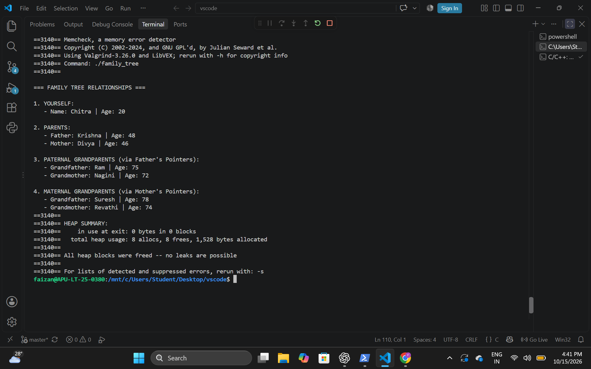

# Family Tree Project

## Project Description

This project is a C program that creates and displays a three-generation family tree.

The program represents 7 family members:
- Yourself
- Father
- Mother
- Paternal Grandfather
- Paternal Grandmother
- Maternal Grandfather
- Maternal Grandmother

The program uses structures, pointers, dynamic memory allocation, and pointer traversal to connect the family members.

## Concepts Used

- C structures (`struct`)
- Pointers
- Dynamic memory allocation using `malloc()`
- Functions
- Pointer traversal
- Memory management using `free()`

## Family Relationships

The program connects:

- Father → Paternal Grandfather and Paternal Grandmother
- Mother → Maternal Grandfather and Maternal Grandmother
- Yourself → Father and Mother

## Milestones

### Milestone 1
Created the `Person` structure and implemented memory allocation.

### Milestone 2
Collected information for the 7 family members.

### Milestone 3
Linked the family members using pointers and printed their relationships.

### Milestone 4
Memory cleanup using `free()` and memory leak testing.

## Program Output

The program displays the details of yourself, your parents, and your four grandparents by following the pointer relationships.

## Screenshot

